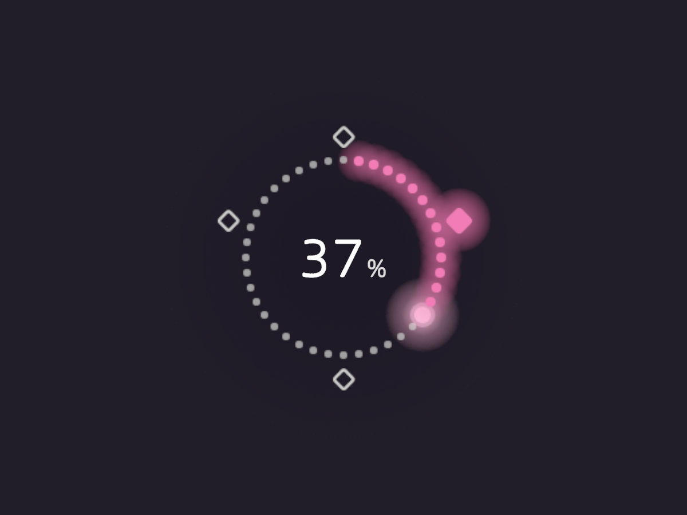
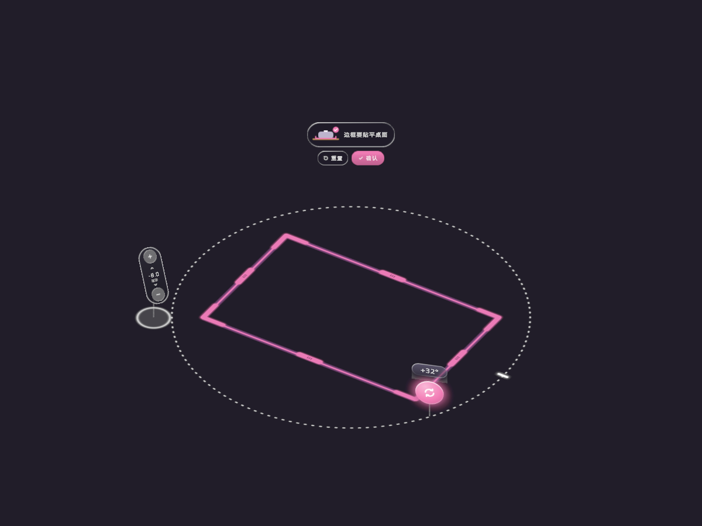
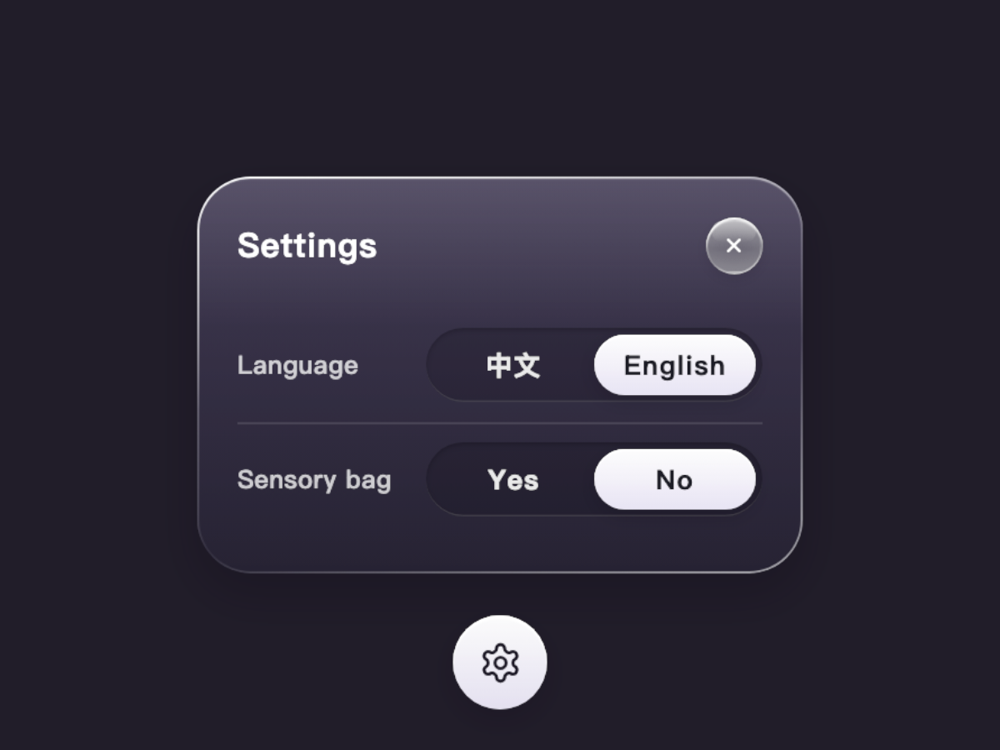

# Moodium UI Refresh 接入与验证

已按用户压缩包的 README、codex-agent-prompt、tokens 与四张预览接入。没有 commit/push。

## 四处替换

| UI | 原实现 | 当前实现 |
|---|---|---|
| Soft 上方能量 | FloatingSqueezeProgress 的 Canvas/Image 横条 | 40颗Sprite点、4颗奖励菱形、项目字体TMP百分比、柔暗底、点亮/呼吸/波纹/满能量闪烁与闲置淡出 |
| 校准旋转 | 两个左/右转5°文字按钮 | 右前角玻璃转钮、拖动时显示虚线圆/零刻度/角度标签，复用RotateFrame绕中心旋转 |
| 两条选关分支的设置 | 文字设置键与临时文字面板 | 齿轮、双语玻璃面板、两行分段开关；立即应用设置，面板保留以播放滑块及语言切换动画 |
| 开机语言/感官袋选择 | Canvas Image胶囊 | 原尺寸Sprite胶囊、系统hover、pressed反馈；保留OpeningVideoSpatialButton、Unity Button与原选择门控 |

51张精灵加载通过，PPU=1857.142857，使用默认Sprite材质，没有新Shader或AR会话。手腕UI未改。开机问题文本保留原有Canvas，不属于替换的胶囊。

## 文件与连接

新增 `UIRefreshVisuals`（精灵、排序、按钮反馈）、`MoodiumUIRefreshLayout`、`SelectionSettingsVisual`、`CalibrationRotateDial`、`OpeningChoiceSpriteFeedback`；导入包内 `UIRefreshAssetPostprocessor`，排序优先级100确保与现有Opening导入器一致。30张新UI贴图、21张开机贴图按原接口名接入，保留已有meta身份。

修改 `FloatingSqueezeProgress`；`CandyWorldManager` 仅补传项目字体和按压唤醒，不改能量算法。`MoodiumAppFlowController`/`WorldCarouselSelectionController` 替换两处分支入口，设置回调仍写原PlayerPrefs、更新session语言并立即重建选关。`MoodiumSpatialButton` 只增加编辑器精灵悬停转发。`OpeningVideoLanguageChoice`/`HardwareChoice` 保留原选择语义与共用回调，按压后显示0.3s再允许视频切换。

`SensoryBagCalibrationRectangle` 的枚举末尾追加Rotate，`SensoryBagCalibrator` 复用已有指针路由和绕框中心旋转，确认/重置继续沿用。未修改 shared spatial gesture router；原先可拖拽的校准handle会自动路由新Rotate类型。

## 与包内假设不同之处

- 现有旋转只有左右5°按钮，没有可直接替换的拖动实现。因此增加拖动角度输入，但复用既有中心、anchor旋转、确认和重置；归零阈值3°，拖动与边/角/框/高度互斥。新增旋转回归测试确认不改变尺寸和中心。
- 设置面板打开时原选关内容仍按既有逻辑挂起。独立面板中显示同位置的打开态齿轮，仍可再次点击关闭；下沿距齿轮可见上沿2cm，避免两者重叠。修改设置立即重建选关，但面板不随之销毁，允许滑块与文字交叉淡化完成。
- 图片是带透明边的完整画布；只对父级非均匀缩放做补偿，不按画布宽度扩大Collider。虚线圆及连接线使用设计允许的尺寸缩放。
- 玻璃质感来自提供的PNG，未增加真实背景模糊。

## 参数与配置

无需新增手动Inspector引用。精灵通过Resources加载，字体沿用项目传入的中英字体。布局主常量在MoodiumUIRefreshLayout，原始tokens也保存到specs。悬浮环位于模型顶部+0.16m，仅绕竖直轴朝向用户；旋转圆边距0.05m、钮心离桌0.05m、命中直径0.06m；设置半行命中0.081×0.036m；开机胶囊命中0.178×0.061×0.01m、中心间距0.2m。

## 已验证与未验证

- Unity 6000.0.30f1 编译完成，没有本次代码编译错误。
- 最后一轮独立针对性验证：43/43 Passed（UIRefreshTests 10、IntroVideoGateTests 18、CalibrationUIv2Tests 5、CalibrationHeightTests 10）。含51张Sprite加载/PPU、能量显示/阈值/字体、设置选项值/贴图、旋转拖动/吸附/互斥/中心不变，以及原开机Unity Button回调。
- 最后一次全项目EditMode快照：604项，557通过、47失败。**不能宣称全项目测试通过。** 多项在旧验证记录已有同名失败；本轮还有另一个正在修改的第二层点云任务的3项失败（canonical frame/eye height）。没有为获得绿色结果修改其他功能或旧断言。完整失败清单在文末。
- 全量测试生成的MoodCheck prefab与字体缓存已恢复到本任务开始时的版本；不把这些测试副作用纳入UI改动。
- 五张图由Unity编辑器加载实际组件、真实Sprite及项目字体后，用离屏Camera渲染。它们验证静态布局，不是Vision Pro截图，也不证明动画/手势已在设备正常运行。
- 尚未进行visionOS构建、设备部署或真机测试。待验：亮暗环境可读性、原生hover、按压/归零/切换动画、双眼透明排序、旋转钮与真实袋子的遮挡、按压唤醒、切换选关后的触控与原视频流程。

## Unity实际组件截图

可从Unity菜单 Moodium → UI Refresh → Capture Verification Previews 重新生成截图，Run EditMode Tests 重新运行测试。该工具不会自动运行。

## 全量测试失败快照

- `BubbleRingTests.FeedbackUsesOneDrawMeshAndReleasesGeneratedAssets`:   Expected: 1
- `BubbleWorldTests.AllWorldsUseCanonicalSourceFrames`:   Expected: less than 0.00100000005f
- `BubbleWorldTests.NestedBakedLayersMatchExportedCloud("MoodiumBubbleWorld/NestedNature/",0.369f)`:   Expected: 0.368999988f +/- 9.99999975E-06f
- `BubbleWorldTests.NestedBakedLayersMatchExportedCloud("MoodiumBubbleWorld/Candy/Nested/",0.56f)`:   Expected: 0.560000002f +/- 9.99999975E-06f
- `CalibratedSensoryBagPresentationTests.VisualFit_MapsFrameWidthAndHeightOntoPrefabTablePlaneXAndZ`:   Expected: 1.0f +/- 9.99999975E-05f
- `CalibratedSensoryBagPresentationTests.VisualRoot_FollowsStickerOrientation_WhileFittingBagXZ`:   Expected: 1.0f +/- 9.99999975E-05f
- `CandyBurstControllerTests.NatureBurstWrapper_DisablesLegacyMaterialAndBoundsCompatibility`:   Expected: False
- `CandyWorldProgressControllerTests.DisabledSpatialTransformationDoesNotStartCandyMeshOverlay`: Unhandled log message: '[Assert] Cancelling DisplayDialog: Hierarchy not allowed An ARMeshManager must be a child of an XROrigin.
- `DualTrackingRealityFlowTests.ImageTrackedCapsuleIncreasesSharedCandyEnergy`: Unhandled log message: '[Error] Destroy may not be called from edit mode! Use DestroyImmediate instead.
- `ImageTrackingCapsuleSpawnerTests.SceneUsesTenCentimetreTestImageLibrary`:   Expected: 1
- `MoodCheckControllerTests.Adjust_PreservesPositionAndReturnsToDragging`: Unhandled log message: '[Error] Instantiating material due to calling renderer.material during edit mode. This will leak materials into the scene. You most likely want to use renderer.sharedMaterial instead.'. Use UnityEngine.TestTools.LogAssert.Expect
- `MoodCheckControllerTests.MovingPlate_UpdatesMoodNameAndDescriptionImmediately`: Unhandled log message: '[Error] Instantiating material due to calling renderer.material during edit mode. This will leak materials into the scene. You most likely want to use renderer.sharedMaterial instead.'. Use UnityEngine.TestTools.LogAssert.Expect
- `MoodCheckControllerTests.NoAvailableWorld_KeepsSampleValidWithoutRecommendation`: Unhandled log message: '[Error] Instantiating material due to calling renderer.material during edit mode. This will leak materials into the scene. You most likely want to use renderer.sharedMaterial instead.'. Use UnityEngine.TestTools.LogAssert.Expect
- `MoodCheckControllerTests.Panel_IsPlacedOnceAheadAndBelowCameraUsingYawOnly`: Unhandled log message: '[Error] Instantiating material due to calling renderer.material during edit mode. This will leak materials into the scene. You most likely want to use renderer.sharedMaterial instead.'. Use UnityEngine.TestTools.LogAssert.Expect
- `MoodCheckControllerTests.PostCheck_StartsAtPrePositionAndCompletesAfterComparisonContinue`: Unhandled log message: '[Error] Instantiating material due to calling renderer.material during edit mode. This will leak materials into the scene. You most likely want to use renderer.sharedMaterial instead.'. Use UnityEngine.TestTools.LogAssert.Expect
- `MoodCheckControllerTests.PreCheck_TransitionsThroughConfirmationRecommendationAndCompletionOnce`: Unhandled log message: '[Error] Instantiating material due to calling renderer.material during edit mode. This will leak materials into the scene. You most likely want to use renderer.sharedMaterial instead.'. Use UnityEngine.TestTools.LogAssert.Expect
- `MoodCheckControllerTests.SkipAndImmediateDismiss_AreIdempotentAndDoNotComplete`: Unhandled log message: '[Error] Instantiating material due to calling renderer.material during edit mode. This will leak materials into the scene. You most likely want to use renderer.sharedMaterial instead.'. Use UnityEngine.TestTools.LogAssert.Expect
- `MoodCheckFlowIntegrationTests.ExitWithPreSampleOpensPostAndSkipClosesVisit`:   Expected: Dragging
- `MoodCheckFlowIntegrationTests.SelectedWorldStartsVisitRegardlessOfRecommendation`: Unhandled log message: '[Error] Instantiating material due to calling renderer.material during edit mode. This will leak materials into the scene. You most likely want to use renderer.sharedMaterial instead.'. Use UnityEngine.TestTools.LogAssert.Expect
- `MoodCheckFlowIntegrationTests.StickerRequest_StoresConfirmedPreSampleAndRecommendation`: Unhandled log message: '[Error] Instantiating material due to calling renderer.material during edit mode. This will leak materials into the scene. You most likely want to use renderer.sharedMaterial instead.'. Use UnityEngine.TestTools.LogAssert.Expect
- `MoodiBreathingFloatTests.CandyWorldUI_MoodiMeshy_HasBreathingFloat`:   Expected: (0.00, 0.02, -0.11)
- `MoodiBreathingFloatTests.NatureWorldUI_MoodiMeshy_HasBreathingFloat`:   Expected: (0.06, 0.02, -0.09)
- `MoodiumOpeningPersistenceTests.OpeningPrefab_KeepsAllRuntimeIntroAssetsAssigned`:   Expected: 32.266666666666666d +/- 0.0001d
- `MoodiVoiceTests.EveryLineHasAChineseAndAnEnglishClip`:   Expected: 48
- `MoodiVoiceTests.FinaleTeachingAndCooldownMatchTheJourney`:   Expected: greater than or equal to 0
- `MoodiVoiceTests.HidingOrStoppingMoodiCancelsItsDelayedInvitation`: System.Reflection.TargetInvocationException : Exception has been thrown by the target of an invocation.
- `MoodiVoiceTests.RescueTeachingWaitIncludesQueuedSpeechAndStopClearsIt`: System.NullReferenceException : Object reference not set to an instance of an object
- `MoodiVoiceTests.TeachingLinesAreSaidOnlyOnceAndNotAfterTheUserLearned`: UnityEngine.MissingComponentException : There is no 'AudioSource' attached to the "Moodi Voice Emitter" game object, but a script is trying to access it.
- `NatureLeafParticleControllerTests.SoftSqueezeFeedbackCreatesTheExistingWhiteCircularBurstAtTheSoftCenter`: Unhandled log message: '[Error] Destroy may not be called from edit mode! Use DestroyImmediate instead.
- `NatureLeafParticleControllerTests.WhiteBurstCircleTextureHasTransparentCornersAndAnOpaqueCenter`: UnityEngine.UnityException : Texture 'Moodium Runtime White Circle' is not readable, the texture memory can not be accessed from scripts. You can make the texture readable in the Texture Import Settings.
- `OpeningGestureGuideTests.OpeningPrefabShowsGestureGuideThreeSecondsAfterCandyInFrontOfCandy`:   Expected: same as <Gesture (UnityEngine.GameObject)>
- `PalmPressWorldSpaceContactTests.DetachedTrackedCapsuleStillIncreasesCandyEnergy`: Unhandled log message: '[Error] Destroy may not be called from edit mode! Use DestroyImmediate instead.
- `PolySpatialVideoRenderTextureUpdaterTests.Updater_OnlyTransfersACreatedRenderTexture`:   Expected: True
- `PortalFallingBagControllerTests.PortalPrefabContainsConfiguredBagRainAndInvisibleChamber`:   Expected: 3
- `PortalFallingBagControllerTests.PortalPrefabIncludesCandyBagInTheFiftyBagLibrary`:   Expected: 3
- `PortalFallingBagControllerTests.PortalPrefabProvidesFloorAndCapacityForPersistentBagStack`:   Expected: 30
- `PortalFallingBagControllerTests.PortalPrefabUsesLargerBalancedBagsForTheFullStack`:   Expected: 30
- `PortalFallingBagControllerTests.SpawnedBagReceivesPhysicsAndStaysInsideSpawnBounds`:   Expected: in range (-0.28,0.28)
- `RealityModeTableVisibilityTests.SelectingRealityCandyWorldDoesNotCreateSpatialTable`: Unhandled log message: '[Error] [Moodium Object World] Missing tracked soft prefab for Candy World.'. Use UnityEngine.TestTools.LogAssert.Expect
- `RealityWorldModelCarouselTests.RealityCarouselBuildsOnlyCandyAndNatureWithCandyInitiallySelected`:   Expected string length 5 but was 6. Strings differ at index 0.
- `RealityWorldModelCarouselTests.RealityCarouselNotifiesCandyAsInitialPreview`:   Expected is <System.String[1]>, actual is <System.Collections.Generic.List`1[System.String]> with 1 elements
- `SensoryBagBranchTests.DefaultConfirmationBypassesFrameAndCompletesOnlyOnce`:   Expected: (0.00, -0.05, 0.00)
- `SensoryBagBranchTests.NoBagMoodConfirmationSkipsRecommendationAndCompletesOnce`: Unhandled log message: '[Error] Instantiating material due to calling renderer.material during edit mode. This will leak materials into the scene. You most likely want to use renderer.sharedMaterial instead.'. Use UnityEngine.TestTools.LogAssert.Expect
- `SensoryBagCalibrationRectangleTests.ProjectWorldPointToAnchorPlane_DiscardsLocalDepth`:   Expected: -0.0299999993f +/- 9.99999975E-05f
- `StickerWorldSelectionControllerTests.MoodEntry_ChangesSummaryAndRaisesRequest`:   Expected: 1
- `StickerWorldSelectionControllerTests.RecommendationTag_AttachesOnlyToMatchingEntryWithoutDisablingButtons`: System.NullReferenceException : Object reference not set to an instance of an object
- `StickerWorldSelectionControllerTests.WorldEntry_UsesGlassSliderWithArrowInsteadOfTextOnlyButton`: System.NullReferenceException : Object reference not set to an instance of an object
