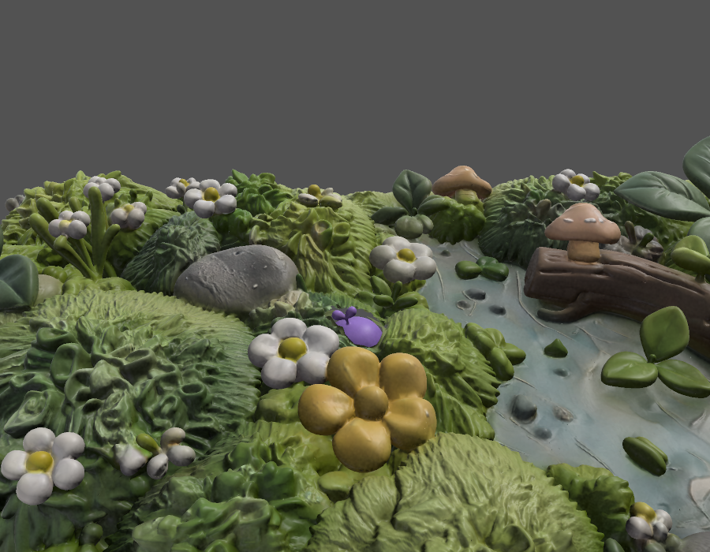
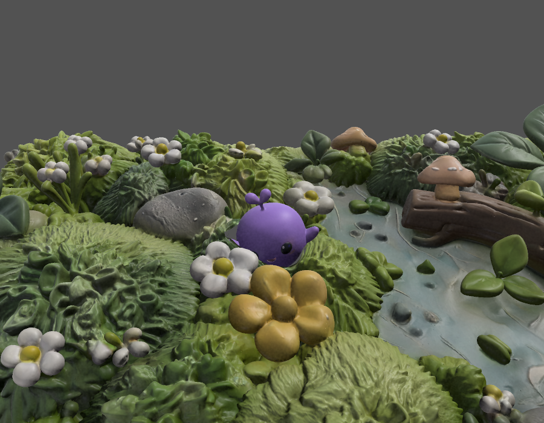
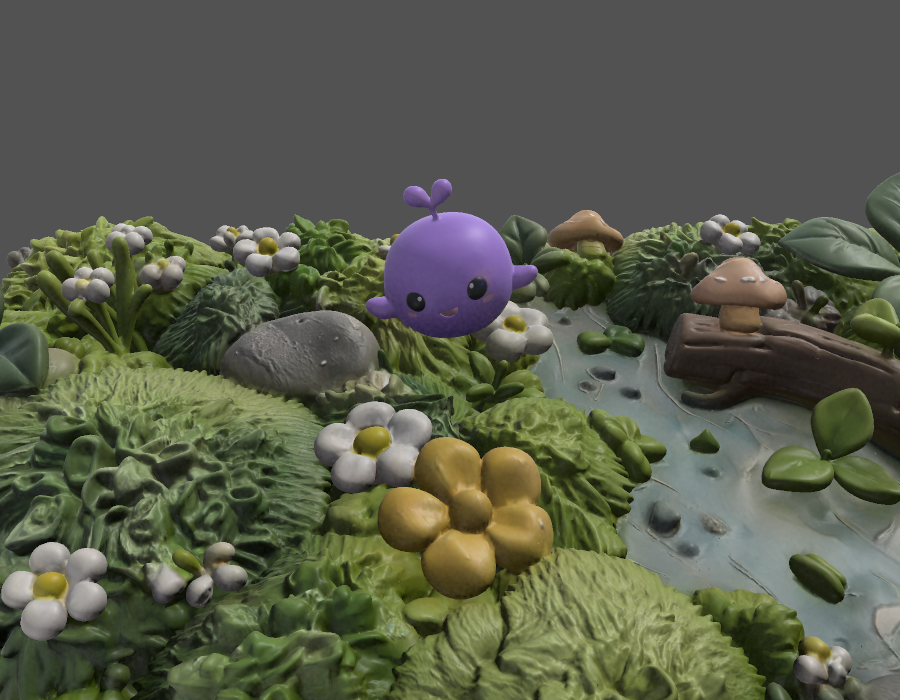
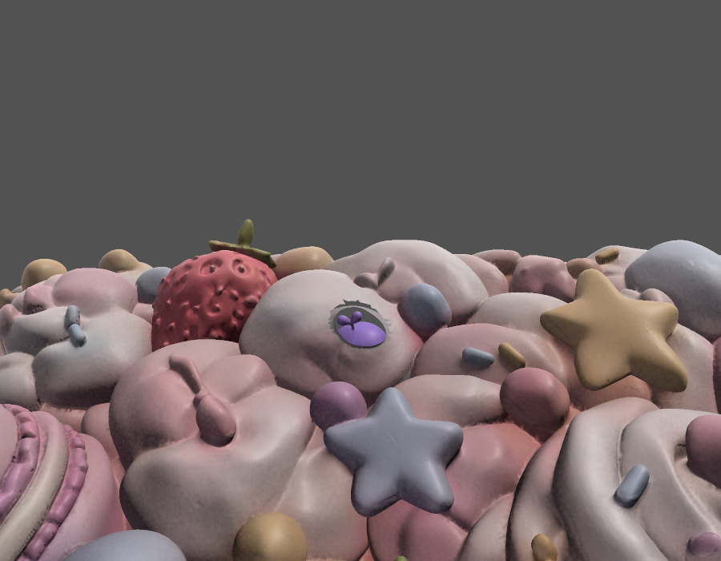
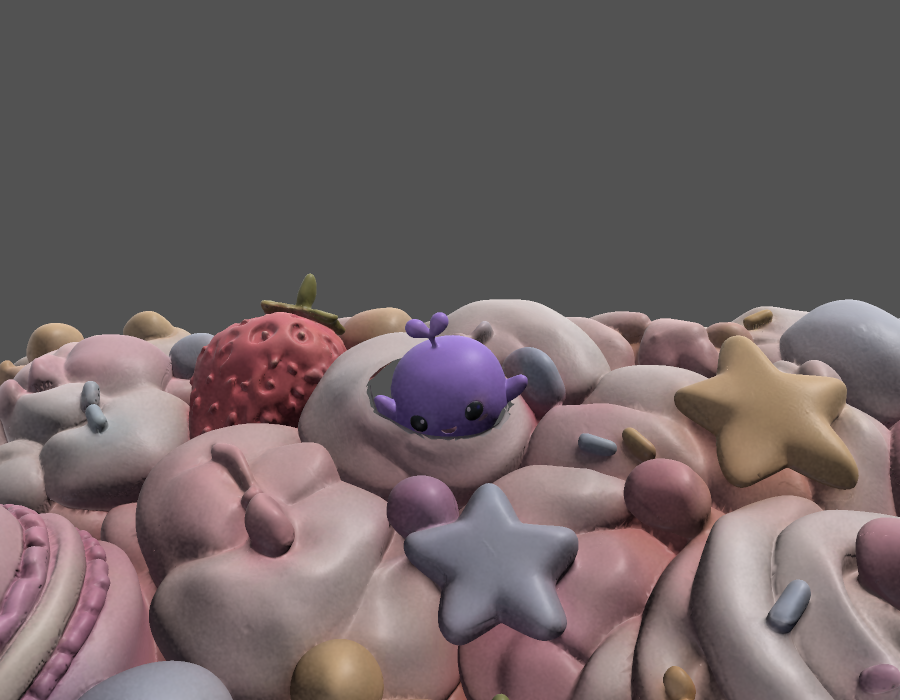
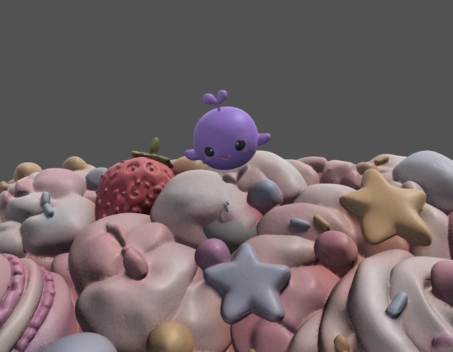

# Moodi 模型挤出救援接入记录

已按 Moodium-MoodiSqueezeOut 的 README 与执行说明接入糖果、自然两套开洞软模型。正常路径使用真实骨骼 Moodi，按压时洞口和身体共同形变，完成后弹出并交回原救援导演。新路径不再预加载透明视频；旧 prefab 缺少 Mouth_Rig 或必要资源时自动启用原视频路径。

## 实现

- `Assets/Model/Moodi_Rigged.fbx` 保留原 GUID，19 根骨骼、9 段源动画。两个 `Assets/Model/Soft/*Soft_Mouth.fbx` 各有 25 根洞口骨骼、3 段动画。
- `Assets/prefab/CandySoft.prefab`、`NatureSoft.prefab` 替换模型子节点，保留根节点交互与音效。新导出已经转换轴向，移除了旧子节点额外的 -90° 修正；洞口 rig 的局部 Z 是实际向上方向。
- `ISqueezeProgressDisplay` 和 `SqueezeProgressDisplayRouter` 隔离模型／视频；`MoodiEmergenceDisplay` 实现对齐、弹簧、平滑进度、探头、快眨、颗粒、单次弹出和复位。无故事配置时使用独立 Moodi；资源不全回退视频。
- `MoodiRescueDirector` 在掉入时交出模型控制权，K3 后开始挤出，弹出时取回模型，沿原弧线恢复大小并交接。保留语音规则、能量、阶段、散步及泡泡流程。
- `MoodiAnimatedSetup` 生成新增状态和 Strain 层；`MoodiEmergenceSetup` 生成两套嘴口控制器、粒子材质、fallback prefab 和模型引用。喉管 Shader Graph 使用顶点色乘世界颜色，Smoothness 0.2。
- `MoodiVoice` 增加只读 RMS 采样供小芽说话摆动；无有效采样使用固定 7 Hz。修复原生 AudioSource/AudioLowPassFilter 使用 CLR 空值判断导致组件未创建的问题，不改变台词和调度规则。

## 参数与适配

Inspector 默认：平滑时间 0.25 秒、最大速度 0.3/秒、弹出阈值 0.995；按压上移 0.26／回弹下移 0.07 个作者单位；快眨闭／睁各 0.1 秒、闭眼比例 0.08；掉入／弹出颗粒 6／14。

FBX 的一个作者单位对应 rig 局部 0.01 米，位移已换算，不会错误地上移数十厘米。弹簧沿用按下 2500/0.85、松开 220/0.32、按下冲量 2.5。

源 FBX 与说明的两处差异已处理：

1. 新文件里的原五段动作时长与旧文件不同。因此从原 FBX 完整保存五段曲线到 `Assets/Animations/Moodi/OriginalClips`，控制器使用这些资产。Idle 3s、Walk 0.8s、Touched 1s、Happy 1.4s、Wave 1.6s。新 FBX 内的源片段保留，不改供应资产。
2. 新导出片段报告 24 fps，而方案按 30 fps 描述。FallIn、Peek、Mouth_Pop 的控制器播放速度补偿到 0.5s、1.2s、0.8s；Emerge/Strain/Pucker 使用归一化 Motion Time，不受 fps 影响。

模型路径必须等待平滑进度完成，不能被原有 1.2 秒兜底过早打断。因此 1.2 秒后继续等待模型，最多再等 8 秒；视频路径的原兜底时间保留。

## 验证

最终相关套件 **94/94 通过**，含新增骨骼／片段、原动作时长、世界矩阵、实际 Animator 位移、弹出唯一性、重进复位、快眨、水平朝向与救援事件顺序测试；同时通过 MoodiAnimated、MoodiRescue、SqueezeProgressVideoController、WalkTrailGuideController、BubbleWorld 相关套件。结果保存为 [tests.xml](moodi-emergence/tests.xml)。Unity 本轮脚本编译无错误。

曾运行全套 621 项，576 通过、45 失败；这是实施中途结果，未宣称全项目全绿，失败清单见 [记录](moodi-emergence/initial-full-suite-failures.txt)。后续单独纳入 MoodiVoice 测试时，仍有旧台词数量／已删除台词预期及旧私有音源字段假设等 4 项失败；它们与新增模型资产无关，未为通过测试而更改语音内容。

下图是 Unity 编辑器对实际 prefab 和动画片段的采样渲染，非真机截屏。100% 图采样洞口 Pop 并把 Moodi 放到弹出位置，用于检查资产衔接，不等同于逐帧录制运行流程。

| 世界 | 0% | 50% | 100% 弹出 |
|---|---|---|---|
| 自然 |  |  |  |
| 糖果 |  |  |  |

尚未完成 Vision Pro 实机验收：重点看 SkinnedMesh 同步、洞口近距离接缝、非等比校准后的按压幅度、颗粒和帧率。未测得实机性能数据，不承诺帧率与视频版完全相同。未提交或推送 Git。
